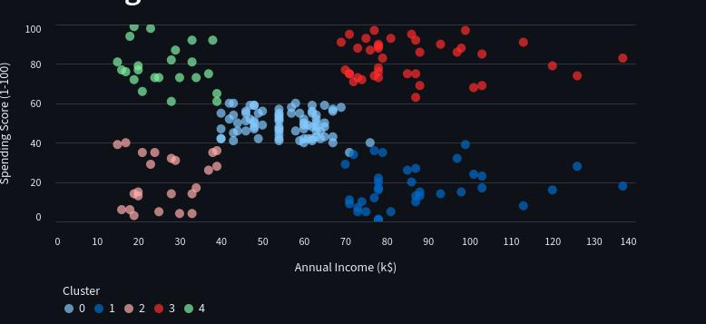

# Mall Customer with K-means

In this project I have applied K-means from scratch in [Mall Customer](https://www.kaggle.com/datasets/shwetabh123/mall-customers) dataset in kaggle. This markdown is just the overview of the project I have given more details in my [notes](https://github.com/gitbhusalhubpramish/ml-notes/tree/main/0.008%20K-means).

This image is just the final result after the clustering the data. [Click here](https://mall-customer-pramish-bhusal.streamlit.app/) to see full anylais of the dataset.

## Small intro to K-means

K-means is a unsupervised clustring meachine learning algorithm. Means it doesn't have a label or doesn't have to predict the output rather clusterize the data, find patterns. We select some points called centroid and optmize them so all points are at minimum distance from it's centroid.

## Feature

This project was made by me to understand K-means from scratch so it's main fearture is it has K-means applied from scratch but also:

- K-means form scratch
- K-means++ for centroid initlization
- Numpy for math and matrix calculation
- pandas for data manipulation
- Data visulization
- Clusters data 

## Tech-Stack

This project uses python liberies used for data science - visulization, caculation and data manipulation. I've used:

- Numpy for math and matrix calculation.
- matplotlib and streamlit for datavisulization
- pandas for csv and data manipulation.

